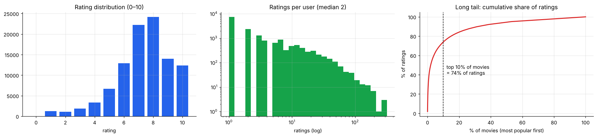
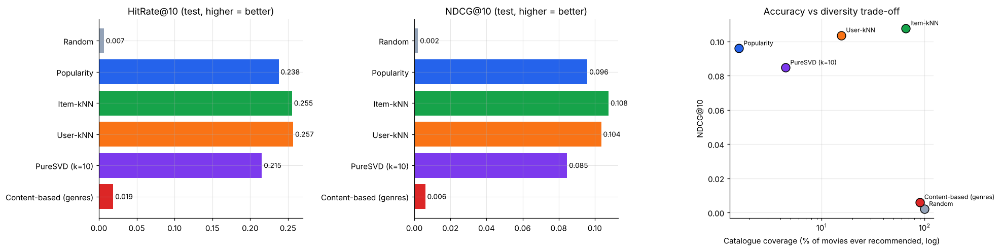
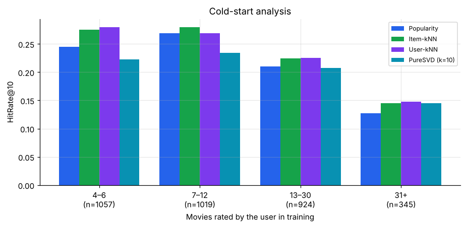

# 🎬 Movie Recommendation System — Collaborative Filtering, Matrix Factorization & Content-Based


A from-scratch comparison of the main recommender-system families on **real, sparse movie ratings**, built with NumPy, SciPy sparse matrices (`svds`) and scikit-learn. Models are evaluated for **rating accuracy**, **ranking quality**, **catalogue coverage**, **novelty** and **cold start**, the questions a product team actually asks.

> Author: **Priyadharshini Sivasankar** · MSc Data Science · [Portfolio](https://priyadharshini2002-source.github.io/priyadharshini-data-science-portfolio/)

---

## 🗂️ Data
**[MovieTweetings](https://github.com/sidooms/MovieTweetings)** 100K snapshot (MIT licence, by Simon Dooms) contains **100,000 real IMDb ratings (0–10)** that 16,554 users posted on Twitter between February and September 2013, covering 10,506 movies.
- The matrix is **99.94% empty**, and the top 10% of movies receive most of the ratings (a long tail).
- After a **5-core filter** (users and movies with ≥ 5 ratings) the data has 68,055 ratings, 4,333 users and 2,414 movies.
- **Time-aware split:** each user's last 2 ratings go to test, the one before to validation (tuning only), and everything earlier to train. A test movie counts as *relevant* when it was rated ≥ 7.



## 🧠 Models
| Task | Model | Built with |
|---|---|---|
| Rating prediction | Global mean, then regularised **user + item biases** (ALS) | NumPy |
| Rating prediction | **Biases + SVD** latent factors, with k tuned on validation | `scipy.sparse.linalg.svds` |
| Top-N | **Popularity** | NumPy |
| Top-N | **Item-based kNN** (cosine item–item similarity, top-100 neighbours) | SciPy sparse + scikit-learn `normalize` |
| Top-N | **User-based kNN** (cosine, 50 neighbours) | SciPy sparse |
| Top-N | **PureSVD** (low-rank reconstruction, k tuned on validation) | `svds` |
| Top-N | **Content-based** (TF-IDF genre profiles) | scikit-learn `TfidfVectorizer` |
| Top-N | **Hybrid** (rank-fusion weights searched on validation) | NumPy |

## 🏆 Results

**Rating prediction (test set, 8,655 ratings)**

| Model | RMSE | MAE |
|---|---|---|
| Global mean | 1.794 | 1.384 |
| User + item biases | 1.477 | 1.093 |
| **Biases + SVD (k = 20)** | **1.476** | **1.091** |

**Top-10 recommendation (test set, 3,913 users)**

| Model | HitRate@10 | Precision@10 | Recall@10 | NDCG@10 | Catalogue coverage | Novelty (bits) |
|---|---|---|---|---|---|---|
| Random | 0.007 | 0.001 | 0.004 | 0.002 | 100% | 8.36 |
| Popularity | 0.238 | 0.027 | 0.163 | 0.096 | 1.6% | 2.75 |
| **Item-kNN** | 0.255 | **0.029** | **0.178** | **0.108** | **65.8%** | 4.31 |
| User-kNN | **0.257** | **0.029** | 0.176 | 0.104 | 15.6% | 3.25 |
| PureSVD (k = 10) | 0.215 | 0.024 | 0.147 | 0.085 | 4.5% | 3.69 |
| Content-based (genres) | 0.019 | 0.002 | 0.012 | 0.006 | 89.9% | 8.34 |

### Key findings
- 📉 **Biases are the big win for rating prediction.** They cut RMSE by 18% (1.79 → 1.48, paired Wilcoxon p ≈ 10⁻²⁵⁷). SVD factors add almost nothing on data this sparse (about 13 ratings per user).
- 🏆 **Item-kNN is the best recommender.** Its NDCG@10 is **+12% over popularity** (paired Wilcoxon p = 0.0002), and it draws on **66% of the catalogue against 1.6%** for popularity, with clearly more novel suggestions.
- 🧪 **More complex ≠ better.** PureSVD scored below popularity, and a validation search over blends of item-kNN, user-kNN, PureSVD and popularity chose **pure item-kNN**, so no hybrid is reported.
- 🏷️ **Genres alone are too coarse.** The content-based model covers the catalogue but barely hits relevant movies, so richer metadata (cast, director, plot embeddings) would be needed.
- ❄️ **Cold start.** Item-kNN beats popularity in every user-history group. Very heavy users (31+ ratings) are the hardest to predict for every method, because their next picks are niche.

## 📊 Screenshots

### Accuracy, ranking and the accuracy-vs-diversity trade-off


### Cold-start analysis


### Demo output (from the notebook)
```
People who rated 'Iron Man 3 (2013)' also rated:
   Star Trek Into Darkness (2013)  (cosine 0.459)
   Man of Steel (2013)             (cosine 0.456)
   Oblivion (2013)                 (cosine 0.405)
   Fast & Furious 6 (2013)         (cosine 0.387)
```

## ▶️ How to run
```bash
pip install -r requirements.txt
jupyter notebook Movie_Recommendation_System.ipynb
```
The data is included in `data/` (MIT licence). If those files are missing, the notebook downloads them from the MovieTweetings repository. The whole notebook runs in about 20 seconds on a laptop and also works in Google Colab.

## 📁 Structure
```
├── Movie_Recommendation_System.ipynb   # full analysis with outputs
├── requirements.txt
├── data/                               # MovieTweetings 100K snapshot + licence
├── figures/                            # plots used above
└── results/                            # rating prediction, top-N comparison, cold start
```

## 🙏 Acknowledgement
Dooms, S., De Pessemier, T., & Martens, L. (2013). *MovieTweetings: a Movie Rating Dataset Collected From Twitter.* Workshop on Crowdsourcing and Human Computation for Recommender Systems, RecSys 2013.
